# 第一课笔记
## 1.linux与发行版
Linux通常指内核；发行版提供一套可以安装和使用的系统
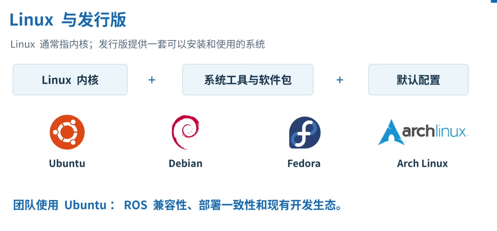
## 2.机器人开发中的Linux
开发电脑通过网络连接机器人主机，控制程序可以在无桌面环境运行
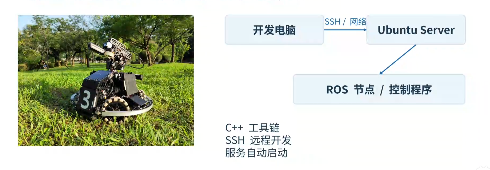
## 3.Linux的目录从/开始
路径大小写敏感；～是当前用户的家目录，.是目前目录，..是上一级
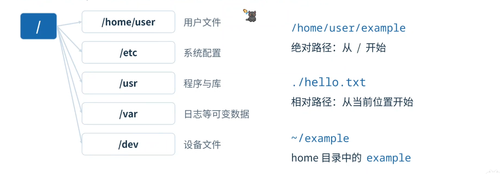
## 4.终端、shell与命令
在终端输入命令，由shell解释再交给程序执行
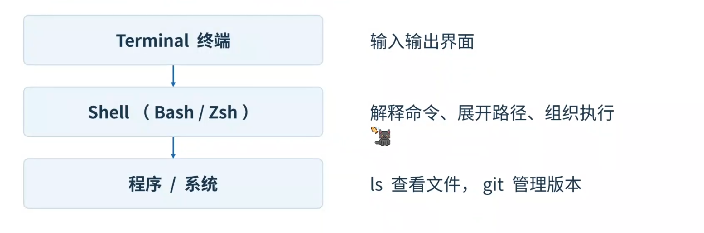
## 5.shell命令的结构
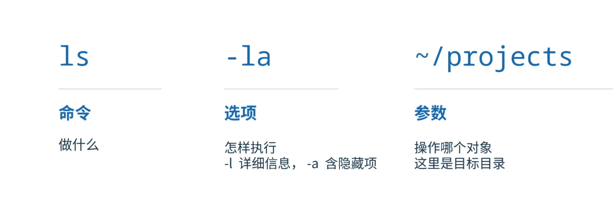
## 6.当前位置与目录切换
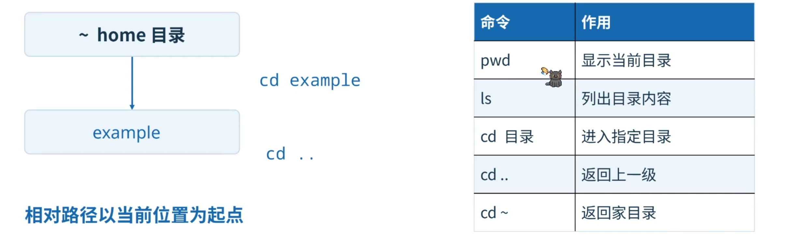
## 7.文件和目录操作
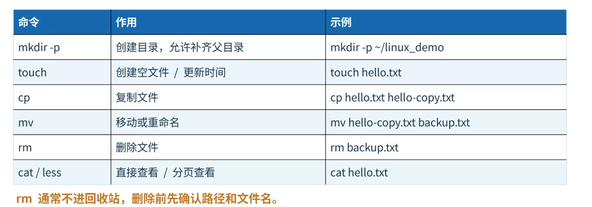
**rm通常不进回收站，删除前请先确认路径和文件名**
## 8.shell的四种常用组合
### 1.变量
name="RM"
rcho "$name"
__保存一个值，再通过变量引用它__
### 2.重定向
echo "hello" > hello.txt
__> 覆盖写入；>> 追加到文件末尾__
### 3.管道
ls -la | grep txt
__将输出交给下一个程序__
### 4.条件连接 
mkdir -p demo && cd demo
__第一条成功后，再执行下一条__
## 9.陌生命令的帮助入口
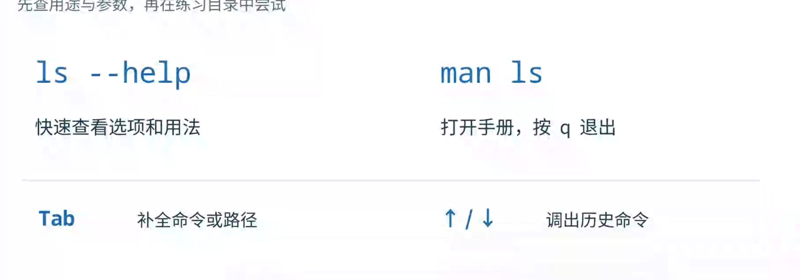
## 10.Vim ： 在终端中编辑文件
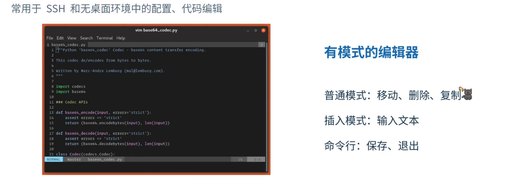
## 11.Vim模式与必备按键
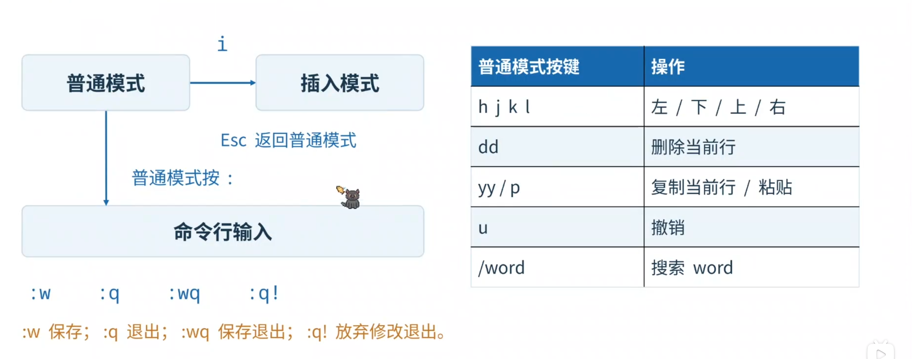
## 12.Vim基本使用
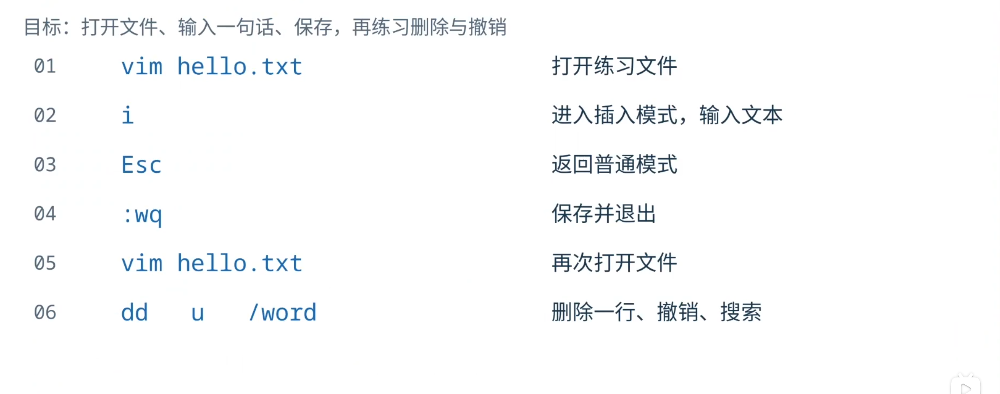
## 13.Git 与 GitHub 的分工

## 14.Git的四个位置
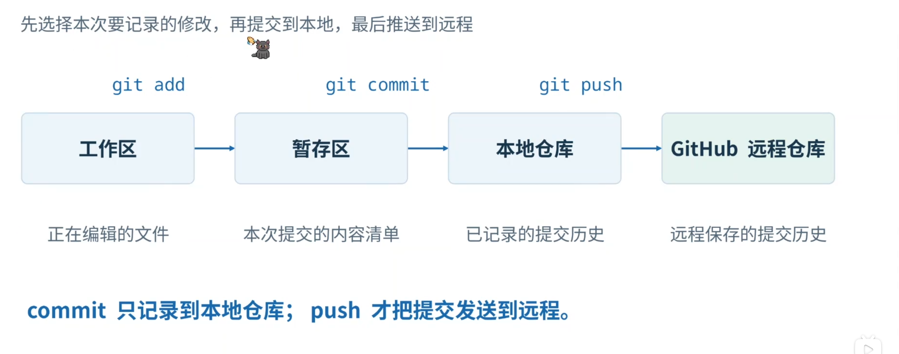
## 15.首次使用Git：提交作者
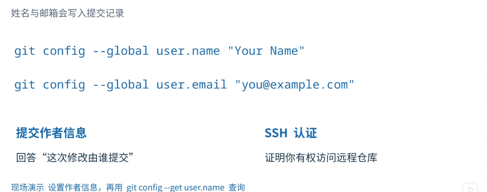
## 16.SSH密钥：公钥与私钥
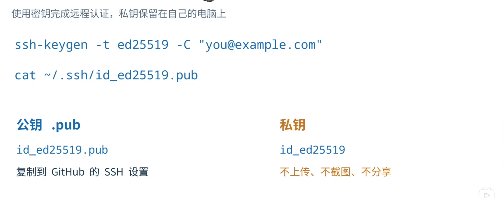
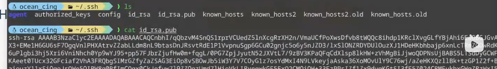
## 17.把SSH公钥添加到Github
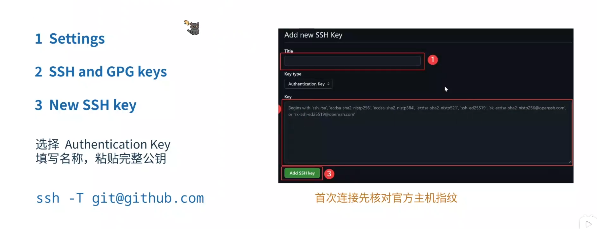
## 18.Git常用命令：获取与查看
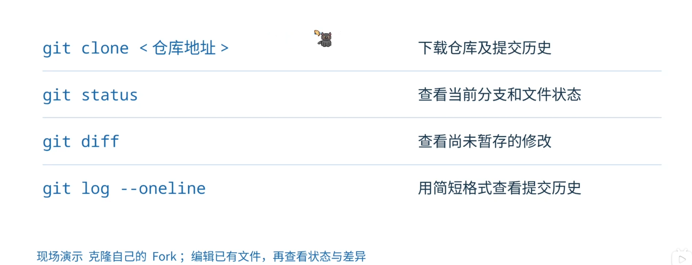
## 19.Git常用命令：分支与提交
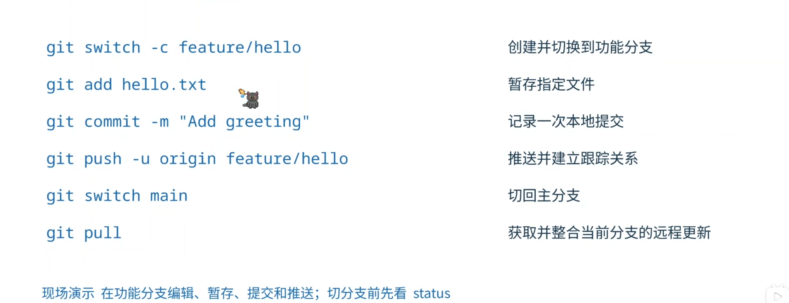
## 20.分支：为新功能保留独立开发线
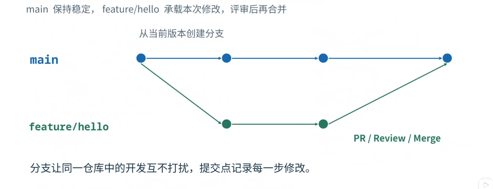
## 21.团队PR工作流
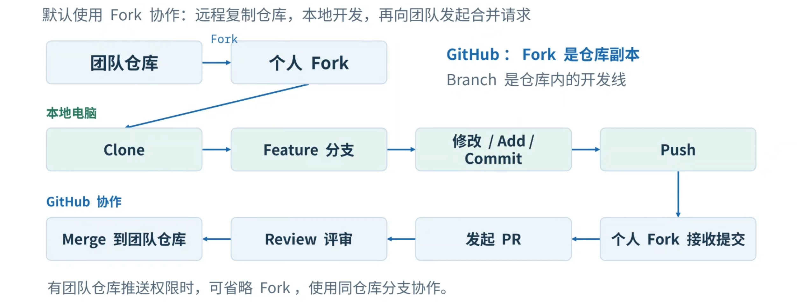
## 22.一次团队贡献的完整过程
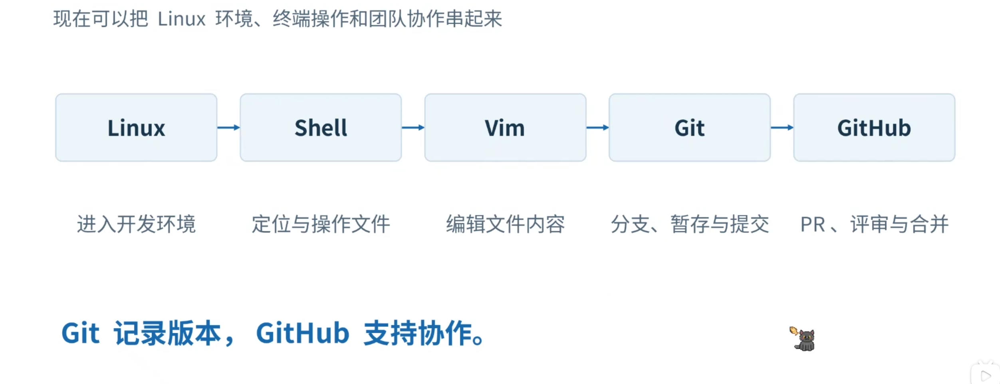
